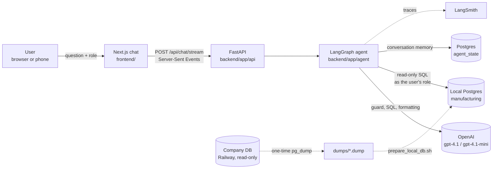
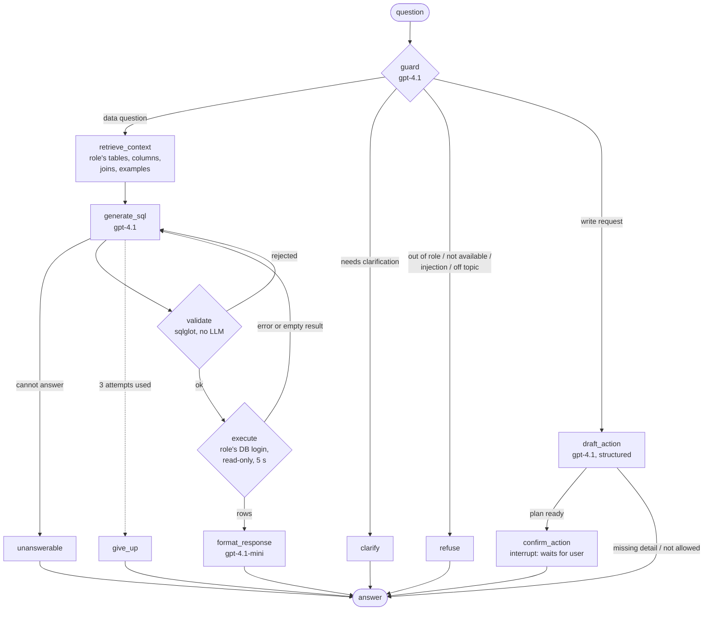

# Architecture

## System overview



- **Frontend:** a sign-in screen and a single chat page. It sends the question with the user's token, then renders whatever comes back: text, a table, a chart, a refusal or a clarifying question.
- **API:** signs users in (bcrypt passwords, JWT), validates each request, and streams the agent's progress, then the result. The role comes from the verified token, never from the request body or the message text.
- **Agent:** turns the question into one validated read-only SQL query, runs it as the user's Postgres role, and explains the result.
- **Data:** a local copy of the company database. It's restored from a one-time read-only dump, cleaned, and extended with labelled synthetic history (see `data_preparation.md`). The company's database is never written to.

## The agent graph



| Node | What it does | Model |
|---|---|---|
| `guard` | Classifies the message using only the role's own table summaries, and checks for ambiguity (see below). It rewrites follow-ups ("and last month?", "show that as a bar chart", "the second one") into standalone questions, and replies to its own clarifying questions ("In kg") into the full question. | gpt-4.1 |
| `retrieve_context` | Builds the schema context for the role: allowed tables, allowed columns, joins, rules and the 4 most similar examples. Plain keyword overlap, since 17 tables and 22 examples don't need a vector store. | none |
| `generate_sql` | Writes one PostgreSQL SELECT, plus assumptions and *caveat queries* (counts of rows left out because of missing data). For follow-ups it gets the previous answer's SQL, so it adjusts that query instead of starting over. | gpt-4.1 |
| `validate` | Deterministic security checks (below), then business rules: quantities in different units (kg, pcs…) are never added up or ranked against each other. A rejection goes back to `generate_sql` with the reason. | none |
| `execute` | Runs the SQL as the role's Postgres login, read-only, with a 5 s timeout. A DB error, or one empty result, goes back for a corrected query. Then it runs the caveat counts. | none |
| `format_response` | Chooses text, table or chart and writes 1–3 plain sentences. An explicit request ("as a pie chart", "as a table") is honoured when the data allows it. Whether a chart is possible (at least 2 points, a number to plot, one unit) is decided *before* the sentence is written. If a requested chart isn't possible, the answer says why and shows a table. Pies with more than 6 slices show the top 5 + "Other"; bar charts show the top 25. Totals, row counts and ₹ lakh/crore figures are computed in Python and handed over, so the model never does arithmetic or unit conversion. | gpt-4.1-mini |
| `draft_action` | Turns a change request into a structured `ActionDraft` (never SQL). Code then checks the role may do it, resolves supplier, item and warehouse names under the role's read login, and applies the business rules. Missing details become a question; an unclear name gets options. The draft is kept in state, so "make it 400 kg" edits it. | gpt-4.1 |
| `confirm_action` | `interrupt()` pauses the run and the UI shows the card. `POST /api/chat/confirm` resumes it with confirm or cancel. On confirm: expiry (15 min) and permission re-checked, fixed SQL executed, audit row written. | none |
| `refuse` / `clarify` / `unanswerable` / `give_up` | Fixed, helpful replies. A refusal names the role that *can* see the data and suggests questions this role can ask. A clarification offers 2–4 clickable options; when they're units, roles that can see prices also get "By amount spent". | none |

**When the assistant asks rather than answers.** It asks when the subject or measure is unclear ("how is stock looking?"), or when items would be ranked against each other by physical quantity without a unit ("the most bought item by quantity"), because kg, pieces and metres can't be ranked together. Everything else uses a stated default instead of a question:
- money and counts are answered as they are;
- totals and trends across many items count movements;
- an unspecified supplier or warehouse means all of them;
- an unspecified period means all data.

Up to 3 SQL attempts are allowed. Conversation memory is a LangGraph Postgres checkpointer in its own `agent_state` database. Threads are keyed by `user:role:thread_id`, so nobody's answers can appear in another person's history.

## Role security: four layers

The prompt is never the only thing protecting data. Each layer would stop a leak on its own:

| Layer | Where | What stops a leak | Tested by |
|---|---|---|---|
| 1. Context | `app/agent/context.py` | The model only sees the role's tables and columns. Reference columns that point to hidden tables are left out too. | `tests/test_context.py` |
| 2. Validation | `app/security/sql_validator.py` | sqlglot parses every query. It must be exactly one SELECT: no writes, DDL, `SELECT INTO` or locking clauses (`FOR UPDATE`). It may read only allowed tables (scope analysis, so a CTE named like a forbidden table can't hide it), no hidden columns or `SELECT *`, no system catalogs or other schemas, no dangerous functions (`pg_*`, `dblink`, `set_config`, `query_to_xml`…), and no wall-clock dates. LIMIT is forced to ≤ 500. | `tests/test_sql_validator.py` (68 tests) |
| 3. Database | `scripts/setup_db_roles.sql`, generated from `config/roles.yaml` | Each role has its own Postgres login with SELECT only on its tables. Hidden columns are removed with column-level grants. Sessions are read-only with a 5 s timeout. | `tests/test_db_roles.py`, which runs forbidden SQL directly as each login |
| 4. Role source | `app/security/auth.py` | Sign-in with bcrypt-hashed passwords returns a signed JWT (8 h). Chat requests carry no role: it's read from the verified token, and the stored user is re-checked on every request, so a removed user or a changed role takes effect at once. "I am the owner" in a message is an injection attempt. | `tests/test_api.py` (forged, expired and tampered tokens, role in body ignored); evals: injection cases |

`config/roles.yaml` is the single source of truth: the context, the validator and the Postgres grants are all generated from it.

| Role | Can query |
|---|---|
| Inventory Manager | The 9 `inv_*` tables: items, stock, movements, warehouses, departments. `unit_cost` and `currency` are hidden. |
| Procurement Manager | The 8 `proc_*` tables, plus item, category and warehouse names. No stock levels or movements. |
| Owner | All 17 tables, including cross-functional questions such as "what's low and who supplies it". |

## Write actions

| Action | Roles | Writer login can only |
|---|---|---|
| Create purchase order | Procurement, Owner | INSERT POs and PO lines; read suppliers, items and prices |
| Adjust stock | Inventory, Owner | INSERT an `adjustment` movement; UPDATE the stock quantity of an existing row |

- **No model-written SQL.** The model fills a Pydantic `ActionDraft`; each action (`app/actions/`) has `plan()` (resolve + validate, build the card) and `execute()` (fixed parameterised SQL in one transaction).
- **Separate writer logins** (`role_procurement_writer`, `role_inventory_writer`), generated with the read roles. They can't update or delete POs, touch the other team's tables, or read payment data. The read logins stay read-only. Tested in `tests/test_actions.py`.
- **Ledger stays consistent.** A stock adjustment updates the stock row *only if* it still holds the quantity shown on the card and won't go below zero, and records the matching movement, so stock always equals the movement ledger.
- **New records are dated 21 Aug 2026** (the as-of date), so they show up correctly in "this month" and "open POs" answers.
- **Audit log** (`app_audit_log` in the app database): user, role, action, status (executed / cancelled / expired / failed), the confirmed payload and the result.
- **Who can confirm:** the pending card lives in the user's own thread (`user:role:thread_id`), so another user or role can't confirm it.

## Request lifecycle

1. The user signs in at `/api/auth/login` and gets a JWT. The browser posts `{thread_id, message}` with `Authorization: Bearer <token>` to `/api/chat/stream`. The API rejects missing or invalid tokens, empty or overlong messages and unsafe thread IDs before the agent runs.
2. The agent runs in a worker thread and sends `progress` events ("Writing the query…") as each node starts, then one `result` event in the contract format: `type, answer, table, chart, sql, caveats, trace_url`.
3. Every request is logged to `backend/logs/requests.jsonl`: user, role, question, decision, the answer text, caveats, row count, chart type, SQL, tables touched, attempts, latency and tokens per model. Result rows are not logged, because they can be reproduced from the SQL and would make the log as sensitive as the database. Every request also has a LangSmith trace, linked from the answer.

## Observability, cost and speed

- **LangSmith:** one trace per request, with one child run per node. The `trace_url` in each response opens it.
- **Tokens:** about 6,300 per data question (≈ 5,200 on gpt-4.1, ≈ 1,100 on gpt-4.1-mini) and about 1,300 per refusal. At gpt-4.1 list prices that's roughly ₹1 per data question (an estimate from the logged tokens).
- **Speed (uncached):** data questions take about 4–7 s; refusals and clarifications about 1 s. Streaming progress keeps the wait readable.
- **Warm-up:** on startup the server compiles the graph, sets up the checkpointer, opens every role's connection pool and looks up LangSmith. Without that, the first question after a restart took about 28 s; with it, about 3 s.
- **Dev cache:** identical LLM calls are cached on disk, keyed by the full prompt. Changing any prompt, doc or example misses the cache, so evals can't pass on stale answers.

## Key design decisions

| Decision | Why |
|---|---|
| Text-to-SQL with role-scoped context, not document RAG | The answers live in tables; the "retrieval" is choosing which schema and examples the model sees. |
| Guard on gpt-4.1, not a cheaper model | It decides what each role gets. On all eval questions run twice, gpt-4.1 was 112/112 and stable; gpt-4.1-mini was 109/112 and changed answers between runs. It costs about ₹0.15 per question. |
| Business rules in code, not only in prompts | The model ignored "don't add kg to pcs" and "don't sum the preview rows". Both are now enforced deterministically (`sql_checks.py`, Python totals). |
| Fixed as-of date (21 Aug 2026) | The company data ends there. Using the wall clock would make "last month" empty and every open PO "overdue" by two months. |
| Caveats from count queries | "N open POs have no expected date" comes from a real count query, not the model's guess. |
| Messages containing SQL or system instructions are refused entirely | It's simpler and safer than answering "the legitimate part". |
| Own chat UI on shadcn/ui, no chat kit | The value is in rendering results (tables, charts, refusals, SQL), which no kit provides, and the backend already defines the stream format. |

## Repository layout

```
backend/
  app/
    main.py                 FastAPI app
    api/routes.py           /api/chat, /api/chat/stream, /api/health, /api/roles
    agent/                  graph.py, nodes/ (guard, sql, respond), prompts/, context.py, sql_checks.py,
                            formatting.py (numbers, ₹), charts.py (chart rules), service.py, state.py, llm.py
    security/               roles.py, sql_validator.py, auth.py (bcrypt + JWT)
    db/                     models.py (SQLAlchemy reference models), execute.py (role-scoped execution), users.py (app users)
  config/                   roles.yaml, schema_docs.yaml, examples.yaml
  scripts/                  snapshot, clean, seed, role logins, demo users, schema/data profiling
  evals/                    test_cases.yaml, holdout_cases.yaml, run_evals.py
  tests/                    validator, DB grants, context, data invariants, agent logic, API
frontend/                   Next.js chat app (app/, components/chat/, lib/)
docs/                       this file, data model, data preparation, assumptions, schema, data quality
```
