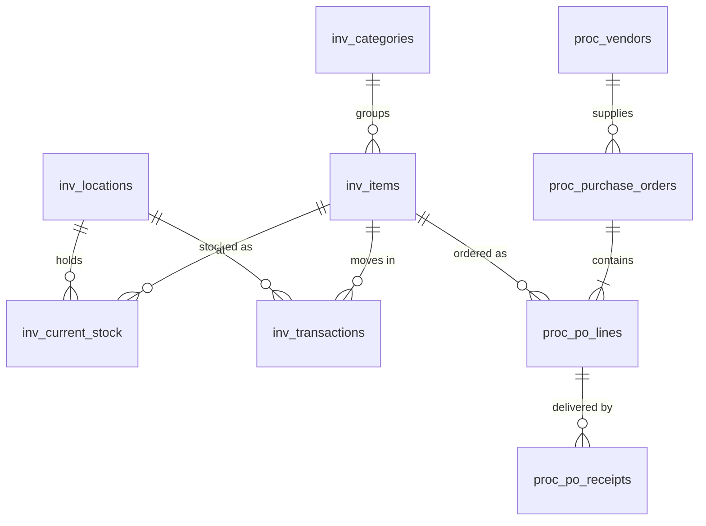

# Data model: which tables matter

There are 17 tables, but seven of them answer almost every realistic question. This page explains which tables those are, how they connect, and which ones only add detail. Column-level meanings live in `backend/config/schema_docs.yaml`; types and keys are in `backend/app/db/models.py`.

## How we ranked them

We counted the tables each of the 37 answerable eval questions needs (`backend/evals/test_cases.yaml`). Seven tables account for 75 of the 83 table uses.

| Table | Uses |
|---|---|
| proc_purchase_orders | 19 |
| inv_items | 14 |
| proc_vendors | 12 |
| inv_current_stock | 10 |
| proc_po_lines | 10 |
| inv_locations | 5 |
| inv_transactions | 5 |
| inv_categories | 3 |
| proc_po_receipts | 2 |
| inv_issued_to_targets, inv_sub_categories, proc_unexpected_receipts (+ headers) | 1 each |
| inv_sub_categories_2, inv_field_definitions, proc_po_line_regularisations, proc_po_payment_tranches | 0 |

## The core seven

| Table | Rows | One row is… | Answers |
|---|---|---|---|
| **proc_purchase_orders** | 119 | a purchase order | Spend, pending and overdue orders, supplier comparisons |
| **inv_items** | 501 | an item (part, raw material, product) | Readable names, units and categories for almost every answer |
| **proc_vendors** | 34 | a supplier | "Who" in procurement answers, payment terms |
| **inv_current_stock** | 560 | an item at a warehouse | On-hand stock, low stock, stock-outs |
| **proc_po_lines** | 223 | an item on a PO | Prices, ordered vs received, pending quantities, spend by item |
| **inv_transactions** | 1,432 | a stock movement | Consumption, receipts, trends, movement history |
| **inv_locations** | 6 | a warehouse | Warehouse names (132-1, 132-2, …) |

## How they connect

- **`inv_items` links the two sides.** Stock, movements and PO lines all point to it.
- **`proc_purchase_orders` is the procurement centre.** A PO has one supplier and many lines, and each line names an item.
- **Owner questions follow one path:** `inv_current_stock → inv_items → proc_po_lines → proc_purchase_orders → proc_vendors`. That's how "what is low on stock, and who did we last buy it from?" is answered. Only the Owner has access to the whole path.

The standard joins:

| From | To | On |
|---|---|---|
| inv_current_stock | inv_items | `inv_current_stock.item_id = inv_items.id` |
| inv_current_stock | inv_locations | `inv_current_stock.location_id = inv_locations.id` |
| inv_transactions | inv_items | `inv_transactions.item_id = inv_items.id` |
| inv_transactions | inv_issued_to_targets | `inv_transactions.issued_to_id = inv_issued_to_targets.id` |
| inv_items | inv_categories | `inv_items.category_id = inv_categories.id` |
| proc_purchase_orders | proc_vendors | `proc_purchase_orders.vendor_id = proc_vendors.id` |
| proc_po_lines | proc_purchase_orders | `proc_po_lines.po_id = proc_purchase_orders.id` |
| proc_po_lines | inv_items | `proc_po_lines.inv_item_id = inv_items.id` |
| proc_po_receipts | proc_po_lines | `proc_po_receipts.po_line_id = proc_po_lines.id` |

Several of these links (stock → item, movement → item, PO line → item) are **not enforced** by foreign keys in the database. They're consistent in the data (no orphans), but a missing match should be treated as possible, not impossible.

## Secondary tables: needed for specific questions

| Table | Needed for |
|---|---|
| **proc_po_receipts** | Supplier delay: compare `received_at` with the PO's promised date |
| **inv_categories**, **inv_sub_categories** | Grouping: "spend by category", "share of items by category" |
| **inv_issued_to_targets** | Department names: "issued to which shop floor" |
| **proc_unexpected_receipts** + **proc_unexpected_receipt_headers** | Goods that arrived without a PO and still need matching |
| **proc_po_payment_tranches** | Payment schedule, what is paid and what is still due |

## Rarely needed

| Table | Why it's rarely used |
|---|---|
| inv_sub_categories_2 | Naming standards for item families. Reference material, not operational data. |
| inv_field_definitions | Configuration of three custom item fields |
| proc_po_line_regularisations | Five quantity corrections on over/under-delivered lines; audit questions only |

## What this means for the assistant

- **Context detail.** The schema context spends most of its detail on the core seven: the tricky column meanings (signed quantities, the revised-date list, "min level 0 = not set") and the standard joins. Rarely used tables get one line each.
- **Few-shot examples** in `backend/config/examples.yaml` lean on joins between the core seven.
- **Role view:**
  - **Inventory** sees four of the core seven: items, stock, movements, warehouses.
  - **Procurement** sees five as well: POs, lines, suppliers, items, warehouses.
  - **Owner** sees all of them, so it's the only role that can follow the whole stock-to-supplier path.
